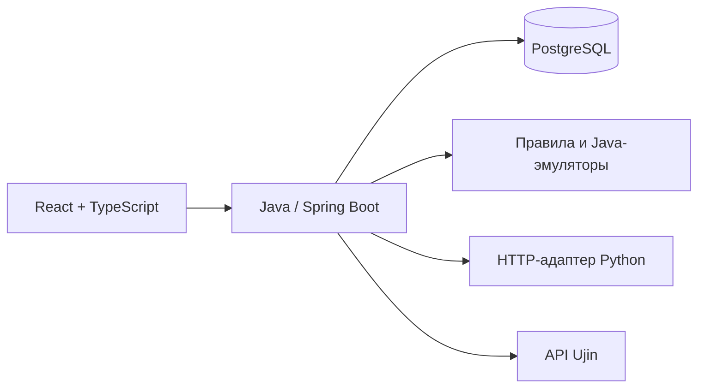

# Hardcode United — Ujin

Веб-приложение команды Hardcode United для создания устройств и сценариев
умного дома. Пример: датчик обнаруживает протечку, правило включает лампу,
а журнал показывает входное событие, решение и результат действия.

[Открыть стенд](https://hardcode-united-ujin.prm21.ru/) ·
[Пошаговая демонстрация](docs/DEMO.md) ·
[API-контракт](docs/contracts/MVP.md)

## Попробовать без учётной записи Ujin

На странице входа нажмите **«Попробовать без Ujin»**. Создайте датчик протечки
и лампу из шаблонов, добавьте локальный сценарий «протечка = 1 → свет = 1».
В карточке датчика нажмите «Вода отсутствует», затем «Обнаружить воду»:
лампа должна включиться, а результат появится в журнале.

Гостевое демо работает через backend и PostgreSQL. Каждая гостевая сессия
получает отдельные данные на 30 минут. Подробности — [в инструкции](docs/GUEST_DEMO.md).

## Возможности и режимы

| Режим | Для чего используется | Ограничения |
| --- | --- | --- |
| LOCAL / Java | Создание устройств, изменение показаний, выполнение правил и журнал | Эмуляция внутри backend |
| LOCAL / Python | Внешние эмуляторы датчика и лампы через HTTP-адаптер | Отдельный стенд и настройка сети; недоступен гостю |
| Ujin | Вход резидента, привязка к SN, чтение доступных сигналов | Нужны назначенные устройства и доступные платформенные сигналы |
| MOCK / готовые примеры | Просмотр синтетических примеров интерфейса | Не подтверждает выполнение сценария на backend |

В приложении есть конструктор сигналов и событий, сценарии, журнал с фильтрами
и страницами, проверка зависимостей при удалении и изоляция данных пользователей.
Это неофициальный инструмент команды, не продукт компании Ujin.

**Состояние интеграции на 1 ноября 2026 года:** чтение назначенного датчика
возвращало только служебные сигналы `dt_create`, `push-connect`, `ver`.
Чтение протечки и полный обмен публикациями/командами пока не подтверждены.
Интерфейс показывает причину отсутствия данных; демо-значения вместо них не подставляются.

## Как устроено



Frontend собирается Vite и обслуживается Nginx. Backend использует Java 25,
Spring Boot и миграции Flyway. Docker Compose запускает приложение и БД;
GitHub Actions проверяет изменения и выкатывает проверенный релиз из `develop`.

| Каталог | Содержимое |
| --- | --- |
| `frontend/` | Интерфейс, формы устройств и сценариев, журнал |
| `backend/ujin/` | API, выполнение правил, адаптеры, миграции и backend-тесты |
| `infra/` | Docker Compose, сборка, deploy, backup и проверки |
| `docs/` | Контракты, сценарий демонстрации и инструкции интеграции |

## Быстрый запуск

Нужны Bash, Docker Engine с Compose v2 (Linux или Docker Desktop), Node.js 22/npm,
Python 3, curl и OpenSSL. JDK 25 используется внутри контейнера сборки.
Для первой сборки нужен интернет. Из чистого checkout:

```sh
git clone git@github.com:egorgubajdulin146-collab/Hardcode-United-Ujin.git
cd Hardcode-United-Ujin
git switch develop
cp .env.example .env
chmod 600 .env
```

Заполните свой .env через редактор, оставьте его вне Git:

```dotenv
COMPOSE_PROJECT_NAME=ujin-local
POSTGRES_DB=ujin
POSTGRES_USER=ujin
POSTGRES_PASSWORD=<случайный пароль локальной БД>
UJIN_HTTP_PORT=8088
UJIN_API_BASE_URL=https://api-uae-test.ujin.tech/api
UJIN_AUTH_APP=
```

API выше — тестовый стенд. Для другого разрешённого контура замените адрес.
Пустой app используется для резидентского входа. Логин/пароль выдаются отдельно
и вводятся в форме браузера, а не сохраняются в репозитории.

```sh
bash infra/build-backend.sh
python3 infra/verify_junit.py backend/ujin/build/test-results/test
npm --prefix frontend ci --ignore-scripts --no-audit --no-fund
npm --prefix frontend run build
export UJIN_IMAGE_TAG=$(git rev-parse HEAD)
docker compose --project-directory . --env-file .env -f infra/compose.yaml -f infra/compose.runtime.yaml config --quiet
docker compose --project-directory . --env-file .env -f infra/compose.yaml -f infra/compose.runtime.yaml build
docker compose --project-directory . --env-file .env -f infra/compose.yaml -f infra/compose.runtime.yaml up -d --wait --wait-timeout 180
```

Откройте http://127.0.0.1:8088. Для интерактивного LOCAL-демо нажмите «Попробовать без Ujin» — учётка платформы не нужна. Для платформенного чтения войдите выданной тестовой учётной записью.
Frontend по умолчанию использует API. Backend и БД не публикуют порты на хост.
Удалённый loopback доступен через SSH-туннель. Публичный HTTPS настраивается
отдельным host Nginx, Compose сам домен и сертификат не создаёт.

## Первый сценарий LOCAL

1. В разделе «Устройства» нажмите «Добавить устройство» и выберите шаблон
   «Датчик протечки». Он заполнит показания `leak` (0 — сухо, 1 — протечка),
   `battery` и событие изменения протечки. Проверьте название и нажмите «Создать».
2. Так же создайте устройство из шаблона «Сигнальная лампа». У него есть
   управляемый сигнал `lamp` (0 — выключено, 1 — включено). Создание в этом
   каталоге не регистрирует оборудование на платформе Ujin.
3. В разделе сценариев создайте правило «При протечке включить свет».
   Где выполнять — «Локально — на эмуляторах»; «Сценарий включён» — да.
   Когда: датчик → «Протечка» → «Изменение протечки».
   Если: «1 — Протечка». Тогда: лампа → «Свет» → «1 — Свет включён».
   Сохраните и откройте заново.
4. В панели лампы выберите «Локальный», отправьте lamp=0. В панели датчика
   выберите «Локальный», нажмите «Вода отсутствует», затем «Обнаружить воду».
5. Откройте ссылку журнала: EVENT, CONDITION, ACTION, RESULT и SUCCEEDED с
   подтверждением lamp=1. Отдельно обновите панель лампы и проверьте значение 1.
6. Выключите правило, верните lamp=0 и повторите 0→1 на датчике.
   Ожидаются SCENARIO_DISABLED и сохранение lamp=0.

Журнал фильтруется по UUID события и сценария.
`/runs?eventId=<UUID>` открывает событие независимо от исходной страницы.
Новые записи идут первыми, размер страницы 20.

## Проверки и сохранность

```sh
npm --prefix frontend run lint
node --test infra/tests/frontend-*.test.mjs
bash infra/test-runtime.sh
```

Тесты deploy/rollback требуют Linux/GNU и `flock`; их полный прогон выполняется
в Linux CI: `python3 -m unittest discover -s infra/tests -v`.
Локальный запуск Docker на macOS не требует этих утилит.

Backend build уже запускает тесты. Runtime smoke не заменяет функциональную
приёмку. PostgreSQL хранит данные в named volume.

```sh
docker compose --project-directory . --env-file .env -f infra/compose.yaml -f infra/compose.runtime.yaml restart postgres backend
docker compose --project-directory . --env-file .env -f infra/compose.yaml -f infra/compose.runtime.yaml up -d --wait --wait-timeout 180
```

После restart backend войдите заново. Команда `down` без `--volumes`
сохраняет БД. `down --volumes` удаляет данные и не подходит для обычного restart.

## Ограничения

- Повтор того же eventId возвращает прежнюю квитанцию без нового действия.
  Новый eventId при неизменном WET записывается как NO_STATE_CHANGE, без повторного
  выполнения. Для нового положительного запуска нужен переход 1→0→1.
- Авторизация и диагностика чтения Ujin существуют. Полный roundtrip
  публикации/downlink этим LOCAL-примером не подтверждён. Проверяйте статус
  возможностей адаптера. Недоступный UJIN не подменяется LOCAL-успехом.
- Старые записи с NULL owner после V3 скрыты. Не присваивайте все такие записи
  первому вошедшему пользователю и не делайте массовый UPDATE владельца.
- Возврат к версии без изоляции аккаунтов не является безопасным rollback.
- Для схемы V1–V9 принят отдельный резерв образов с сохранением owner-изоляции;
  точные SHA/IDs, ограничения функций и порядок возврата — в
  [инструкции отката](infra/ROLLBACK.md). Старый резерв V1–V3 к V9 не применять.

## Документация и deploy

[Runtime](infra/RUNTIME.md), [backup/restore](infra/README.md),
[безопасный rollback](infra/ROLLBACK.md), [контракт](docs/contracts/MVP.md),
[frontend development](frontend/README.md), [демонстрация и приёмка](docs/DEMO.md),
[гостевое демо](docs/GUEST_DEMO.md), [LOCAL-Python адаптер](docs/PYTHON_LOCAL.md).

CI проверяет backend/frontend/инфраструктуру. Push в develop после успешных
проверок публикует артефакт и запускает SSH deploy при настроенных vars
DEPLOY_HOST/DEPLOY_USER и secrets DEPLOY_SSH_KEY/DEPLOY_KNOWN_HOSTS.
PR, main и workflow_dispatch автоматически не деплоятся.
CI/deploy не заменяют приёмку фактического runtime SHA.

Публикация текущих показаний после привязки устройства: [настройка и квитанции](docs/UJIN_PUBLICATION.md).
Включается оператором для назначенных устройств; реальный результат проверяется отдельным чтением.

Доставка команд через Ujin: [настройка и ограничения](docs/UJIN_COMMAND_DELIVERY.md).
Она выключена по умолчанию. Наличие кода и зелёный CI не подтверждают live roundtrip.

Порядок работы: [CONTRIBUTING.md](CONTRIBUTING.md).
